<a id="top"></a>

<div align="center">

# 🎭 FACIAL EMOTION RECOGNITION

### Nhận diện cảm xúc khuôn mặt · IMP302 · Lab 01

**Từ một khung hình đến bảy sắc thái cảm xúc**


**🖼️ Ảnh tĩnh &nbsp; · &nbsp; 🎞️ Video &nbsp; · &nbsp; 📱 Camera mạng &nbsp; · &nbsp; 🌐 Giao diện web**

[🚀 Cài đặt](#section-4) · [📊 Kết quả](#section-2) · [🌐 Web camera](#section-8) · [🛠️ Xử lý lỗi](#section-12)

</div>

---

| 👨‍🎓 Sinh viên | 🪪 Mã số sinh viên | 📚 Bài thực hành |
|:---:|:---:|:---:|
| **Nguyễn Minh Chánh** | **CE180818** | **IMP302 — Lab 01** |

> [!NOTE]
> Dự án đã kèm trọng số CNN, EfficientNet-B0 và YuNet. Sau khi cài thư viện, bạn có thể chạy suy luận mà không cần dataset huấn luyện.

Ứng dụng nhận diện bảy cảm xúc khuôn mặt từ ảnh, video và luồng camera qua mạng. Hệ thống sử dụng YuNet để phát hiện khuôn mặt, sau đó phân loại bằng CNN tự thiết kế hoặc EfficientNet-B0. Có thể chạy bằng dòng lệnh hoặc xem camera qua giao diện web.

<details open>
<summary><strong>🧭 Mục lục — chọn phần bạn cần</strong></summary>

| Khởi động | Sử dụng | Tìm hiểu thêm |
|---|---|---|
| [✨ Tính năng](#section-1) | [🖼️ Ảnh tĩnh](#section-5) | [⚙️ Cấu hình](#section-9) |
| [📊 Kết quả](#section-2) | [🎞️ Video](#section-6) | [🧠 Trọng số ONNX](#section-10) |
| [🗂️ Cấu trúc](#section-3) | [📱 DroidCam](#section-7) | [📓 Huấn luyện](#section-11) |
| [🚀 Cài đặt](#section-4) | [🌐 Web camera](#section-8) | [🛠️ Xử lý lỗi](#section-12) |

</details>

---

<a id="section-1"></a>

## ✨ 1 · Chức năng

- Phát hiện và phân loại nhiều khuôn mặt trong cùng khung hình theo batch.
- Vẽ khung khuôn mặt, nhãn cảm xúc, độ tin cậy và thông tin FPS.
- Suy luận bằng PyTorch hoặc ONNX Runtime; lựa chọn CPU/CUDA tùy môi trường.
- Ổn định dự đoán trên video bằng theo dõi IoU và trung bình trượt xác suất (EMA).
- Kết nối lại khi luồng camera mạng bị gián đoạn.
- Lưu ảnh/video kết quả và thông tin suy luận dạng JSON.

Thứ tự các lớp:

| Nhãn | Ý nghĩa |
|---|---|
| 😠 `angry` | Tức giận |
| 🤢 `disgust` | Ghê tởm |
| 😨 `fear` | Sợ hãi |
| 😊 `happy` | Vui vẻ |
| 😐 `neutral` | Trung tính |
| 😢 `sad` | Buồn |
| 😲 `surprise` | Ngạc nhiên |

---

<a id="section-2"></a>

## 📊 2 · Mô hình và kết quả

| Mô hình | Tham số CLI | Accuracy | Macro F1 | Số tham số |
|---|---|---:|---:|---:|
| M1 — CNN residual kết hợp SE | `--model cnn` | 68,43% | 66,00% | 1.003.935 |
| M2 — EfficientNet-B0 transfer learning | `--model transfer` | 72,04% | 71,31% | 4.015.939 |

Các chỉ số trên được lấy từ `weights/models/m1/model_info.json` và `weights/models/m2/model_info.json`, tương ứng với các notebook huấn luyện FER-2013 đi kèm; không phải kết quả đánh giá lại trong lần cập nhật README này. Mô hình mặc định là `transfer`.

### 🔄 Quy trình xử lý

```mermaid
flowchart LR
    A["Ảnh / Video / Camera"] --> B["YuNet: phát hiện khuôn mặt"]
    B --> C["Crop / Grayscale / Resize / Normalize"]
    C --> D["CNN hoặc EfficientNet-B0"]
    D --> E["Tracking và EMA cho video/stream"]
    E --> F["Vẽ kết quả / Lưu file / Web"]
    style A fill:#dbeafe,stroke:#2563eb,color:#172554
    style B fill:#ede9fe,stroke:#7c3aed,color:#2e1065
    style C fill:#fef3c7,stroke:#d97706,color:#451a03
    style D fill:#fce7f3,stroke:#db2777,color:#500724
    style E fill:#ccfbf1,stroke:#0d9488,color:#042f2e
    style F fill:#dcfce7,stroke:#16a34a,color:#052e16
```



**Tiền xử lý:** grayscale → resize `64×64` → `float32 / 255` → normalize mean `0,5`, std `0,5`. Tracking và EMA chỉ áp dụng cho video/stream khi được bật.

EfficientNet-B0 tiếp tục chuyển chuẩn hóa sang mean `0,449`, std `0,226` và nội suy lên `160×160` bên trong mô hình để khớp kiến trúc notebook.

---

<a id="section-3"></a>

## 🗂️ 3 · Cấu trúc dự án

```text
CE180818_NGUYEN_MINH_CHANH_Lab01/
├── README.md
├── requirements.txt
├── config.yaml
├── notebooks/
│   ├── Notebook_CNN.ipynb         # Huấn luyện CNN
│   └── efficientnetb0.ipynb       # Huấn luyện EfficientNet-B0
├── src/
│   ├── app.py                     # CLI ảnh, video và camera mạng
│   ├── web_app.py                 # Web theo dõi camera
│   ├── model.py                   # Điểm vào định nghĩa mô hình
│   ├── detector.py                # Điểm vào phát hiện khuôn mặt
│   ├── predict.py                 # Điểm vào dự đoán
│   ├── core/                     # Đọc cấu hình và tìm gốc dự án
│   ├── inference/                # Tiền xử lý, detector, predictor, pipeline,
│   │                             # tracking, nguồn dữ liệu và vẽ kết quả
│   ├── models/                   # Kiến trúc và registry mô hình
│   └── training/                 # Tiện ích checkpoint
└── weights/
    ├── detector/
    │   └── face_detection_yunet_2023mar.onnx
    └── models/
        ├── m1/                   # CNN: checkpoint, ONNX, metadata, cấu hình
        └── m2/                   # EfficientNet-B0: tương tự M1
```

Thư mục `outputs/` được tạo khi lưu kết quả. Dataset và ảnh/video thử nghiệm không có trong bản dự án hiện tại. Khi đóng gói bài nộp, có thể đặt thêm báo cáo `REPORT.pdf` tại thư mục gốc; file này chưa có trong thư mục được kiểm tra.

---

<a id="section-4"></a>

## 🚀 4 · Cài đặt

Các lệnh dưới đây dùng PowerShell trên Windows. Sử dụng Python 3.11 để tạo môi trường cho bộ thư viện đã khai báo trong dự án.

Mở terminal tại thư mục dự án và chạy:

```powershell
py -3.11 -m venv .venv
.\.venv\Scripts\python.exe -m pip install --upgrade pip
.\.venv\Scripts\python.exe -m pip install -r requirements.txt
```

Các lệnh dùng trực tiếp Python của môi trường ảo nên không cần kích hoạt bằng `Activate.ps1`.

Thư viện chính: PyTorch `2.6.0`, torchvision `0.21.0`, NumPy, OpenCV, ONNX Runtime, PyYAML và tqdm. Chi tiết phiên bản nằm trong `requirements.txt`.

Kiểm tra giao diện dòng lệnh:

```powershell
.\.venv\Scripts\python.exe src/app.py --help
.\.venv\Scripts\python.exe src/web_app.py --help
```

> [!IMPORTANT]
> Luôn chạy tại thư mục chứa `config.yaml`. Các đường dẫn tương đối của dữ liệu, trọng số và kết quả được tính từ gốc dự án. Không cần dataset để chạy suy luận với trọng số có sẵn.

---

<a id="section-5"></a>

## 🖼️ 5 · Chạy ảnh tĩnh

Đặt ảnh của bạn vào thư mục dự án, ví dụ `test.jpg`:

```powershell
.\.venv\Scripts\python.exe src/app.py --source test.jpg --model transfer
.\.venv\Scripts\python.exe src/app.py --source test.jpg --model cnn --backend onnxruntime --device cpu
```

Mặc định, kết quả được lưu thành `outputs/test_pred.jpg` và bản tóm tắt `outputs/test_pred.json`.

Chọn đường dẫn đầu ra:

```powershell
.\.venv\Scripts\python.exe src/app.py --source test.jpg --model transfer --output outputs/result.jpg
```

---

<a id="section-6"></a>

## 🎞️ 6 · Chạy video

Thay `test.mp4` bằng video thực tế:

```powershell
.\.venv\Scripts\python.exe src/app.py --source test.mp4 --model transfer --display
.\.venv\Scripts\python.exe src/app.py --source test.mp4 --model cnn --output outputs/result.mp4
```

Video mặc định được lưu tại `outputs/test_pred.mp4`, kèm tóm tắt JSON. Dùng `--max-frames 100` để giới hạn số khung hình khi thử nghiệm. Nhấn `q` hoặc `Esc` để đóng cửa sổ xem video.

---

<a id="section-7"></a>

## 📱 7 · Chạy camera điện thoại qua DroidCam

1. Kết nối điện thoại và máy tính vào cùng mạng Wi-Fi.
2. Mở DroidCam trên điện thoại, bật camera và ghi lại IP cùng cổng hiển thị.
3. Kiểm tra URL video của điện thoại trên trình duyệt, sau đó đóng tab kiểm tra trước khi chạy ứng dụng.
4. Thay địa chỉ trong ví dụ bên dưới bằng địa chỉ camera thực tế.

> [!TIP]
> IP bên dưới chỉ là ví dụ. Hãy thay bằng IP và cổng đang hiển thị trên điện thoại của bạn.

Ví dụ camera có URL `http://192.168.1.2:4747/video`:

```powershell
.\.venv\Scripts\python.exe src/app.py --source http://192.168.1.2:4747/video --model transfer
```

Dùng CNN và CPU:

```powershell
.\.venv\Scripts\python.exe src/app.py --source http://192.168.1.2:4747/video --model cnn --backend onnxruntime --device cpu
```

Ghi luồng camera ra file, không mở cửa sổ xem:

```powershell
.\.venv\Scripts\python.exe src/app.py --source http://192.168.1.2:4747/video --model cnn --output outputs/camera.mp4 --no-display --max-frames 300
```

Luồng mạng mặc định có cửa sổ xem và chỉ được ghi khi có `--output`. Có thể giảm kích thước xử lý bằng `--stream-width 640`; nếu chỉ đặt chiều rộng, ứng dụng giữ tỉ lệ ảnh. Nhấn `q`/`Esc` trong cửa sổ xem hoặc `Ctrl+C` tại terminal để dừng.

CLI nhận đường dẫn ảnh/video hoặc URL HTTP, HTTPS, RTSP, RTMP; hiện chưa có lựa chọn webcam USB bằng chỉ số `0`.

---

<a id="section-8"></a>

## 🌐 8 · Giao diện web camera

```powershell
.\.venv\Scripts\python.exe src/web_app.py --source http://192.168.1.2:4747/video --model transfer --backend onnxruntime
```

Mở **http://127.0.0.1:8000** trên trình duyệt để xem video có khung khuôn mặt, nhãn cảm xúc, confidence, FPS, số khuôn mặt và trạng thái kết nối. Server có cơ chế thử kết nối lại khi nguồn camera gián đoạn.

Đổi cổng hoặc mô hình:

```powershell
.\.venv\Scripts\python.exe src/web_app.py --source http://192.168.1.2:4747/video --model cnn --port 8088
```

Khi đó truy cập **http://127.0.0.1:8088**. Nhấn `Ctrl+C` tại terminal để dừng server.

---

<a id="section-9"></a>

## ⚙️ 9 · Cấu hình và tham số

`config.yaml` chứa cấu hình mặc định; các tham số CLI tương ứng sẽ ghi đè cấu hình cho lần chạy đó.

| Tham số CLI | Công dụng / mặc định |
|---|---|
| `--source` | Đường dẫn dữ liệu hoặc URL camera; bắt buộc với CLI |
| `--source-kind auto/image/video/stream` | Chọn loại nguồn; mặc định tự nhận diện |
| `--model cnn/transfer` | Mặc định `transfer` |
| `--backend auto/onnxruntime/pytorch` | Mặc định `auto` |
| `--device auto/cpu/cuda` | Mặc định `auto` |
| `--output` | Chọn file kết quả |
| `--checkpoint`, `--onnx-model` | Dùng trọng số tương thích khác |
| `--face-threshold` | Ngưỡng phát hiện khuôn mặt; mặc định `0.8` |
| `--confidence-threshold` | Ngưỡng độ tin cậy cảm xúc; mặc định `0.5` |
| `--detector-max-side` | Cạnh dài tối đa đầu vào detector; mặc định `640`, dùng `0` để tắt resize |
| `--crop-padding` | Padding vùng khuôn mặt; mặc định `0.1` |
| `--no-temporal` | Tắt ổn định cảm xúc theo thời gian |
| `--ema-alpha` | Hệ số EMA; mặc định `0.55` |
| `--display`, `--no-display` | Điều khiển cửa sổ xem của CLI |
| `--max-frames` | Giới hạn số khung hình xử lý |
| `--stream-width`, `--stream-height` | Kích thước xử lý nguồn mạng; chỉ dùng với stream |
| `--onnx-threads`, `--torch-threads` | Số luồng suy luận; cấu hình hiện tại là `4` |

Bảng trên dành cho `src/app.py`. Web server có bộ tham số riêng: `--source`, `--model`, `--backend`, `--host`, `--port`. Xem `--help` của từng chương trình để biết đầy đủ.

Trên CPU, chế độ `auto` ưu tiên ONNX Runtime khi có artifact ONNX. Trên máy có CUDA, chế độ tự động ưu tiên PyTorch với tối ưu GPU. Gói `onnxruntime` trong requirements phục vụ CPU; muốn sử dụng ONNX trên GPU cần môi trường ONNX Runtime GPU và CUDA tương thích.

Ví dụ chỉ định PyTorch:

```powershell
.\.venv\Scripts\python.exe src/app.py --source test.jpg --model transfer --backend pytorch --device cpu
```

---

<a id="section-10"></a>

## 🧠 10 · Trọng số và ONNX

| Mô hình | Checkpoint PyTorch | ONNX |
|---|---|---|
| M1 | `weights/models/m1/Notebook_CNN_best_model.pth` | `weights/models/m1/Notebook_CNN.onnx` |
| M2 | `weights/models/m2/EfficientNetB0_best_model.pth` | `weights/models/m2/EfficientNetB0.onnx` |

Giữ các file `.metadata.json` cùng thư mục với ONNX. Các thư mục mô hình còn chứa `model_info.json` và `run_config.json` để tra cứu thông tin mô hình và cấu hình.

Hai ONNX sử dụng opset `17`, batch động, đầu vào `B×1×64×64` và đầu ra `B×7`. Metadata đi kèm ghi nhận kiểm tra parity trên batch 4 đầu vào ngẫu nhiên:

| Mô hình | Sai số tuyệt đối lớn nhất ONNX/PyTorch | Top-1 |
|---|---:|---|
| CNN | 1,31e-6 | Trùng khớp |
| EfficientNet-B0 | 1,11e-5 | Trùng khớp |

Đây là thông tin kiểm tra đã lưu trong artifact, không phải phép đánh giá độ chính xác trên toàn bộ dataset.

---

<a id="section-11"></a>

## 📓 11 · Notebook huấn luyện

- `notebooks/Notebook_CNN.ipynb`: mô hình CNN tự thiết kế.
- `notebooks/efficientnetb0.ipynb`: mô hình EfficientNet-B0.

Để huấn luyện lại, chuẩn bị dataset FER-2013, mở notebook bằng môi trường hỗ trợ Jupyter và điều chỉnh đường dẫn dữ liệu/đầu ra trong notebook. Kiểm tra các import và cài thêm thư viện phân tích, trực quan hóa nếu notebook yêu cầu; `requirements.txt` hiện phục vụ chạy ứng dụng và nạp artifact. Dataset và môi trường Jupyter không được đóng gói trong thư mục này. Nên dùng GPU khi huấn luyện.

---

<a id="section-12"></a>

## 🛠️ 12 · Xử lý lỗi thường gặp

| Hiện tượng | Cách xử lý |
|---|---|
| Không tìm thấy `config.yaml` | Mở terminal tại gốc dự án trước khi chạy |
| `ModuleNotFoundError` | Cài requirements bằng đúng `.venv\Scripts\python.exe` đang dùng |
| Không cài được PyTorch | Kiểm tra đang dùng Python 3.11 và pip đã được cập nhật |
| Không tìm thấy ảnh/video | Thay tên ví dụ bằng file thực tế; đặt đường dẫn có dấu cách trong dấu ngoặc kép |
| Thiếu checkpoint/ONNX/YuNet | Kiểm tra các file trong `weights/` và đường dẫn đã khai báo |
| Không dùng được CUDA | Chạy với `--device cpu`; kiểm tra lại môi trường GPU nếu cần |
| FPS thấp | Thử CNN, ONNX Runtime trên CPU, giảm kích thước stream hoặc kích thước đầu vào detector |
| Web báo cổng đang được dùng | Chọn cổng khác bằng `--port 8088` |
| Không kết nối được DroidCam | Kiểm tra IP, cổng, camera đã bật, cùng Wi-Fi và quyền firewall |
| DroidCam báo busy/unavailable | Dừng ứng dụng dùng camera, đóng tab URL `/video`, mở lại camera rồi kết nối FER |

Với DroidCam, sau khi kiểm tra URL trực tiếp, chỉ mở trang FER ở `127.0.0.1` khi chạy web để hạn chế tranh chấp luồng camera. Nếu không kết nối được, kiểm tra VPN và tính năng cô lập thiết bị của mạng Wi-Fi.

---

<a id="section-13"></a>

## 📌 13 · Giới hạn

Kết quả phụ thuộc ánh sáng, góc mặt, kích thước khuôn mặt và khác biệt giữa dữ liệu thực tế với dữ liệu huấn luyện. FPS thay đổi theo phần cứng, backend, độ phân giải và số khuôn mặt. Dự đoán biểu cảm từ hình ảnh là đầu ra của mô hình, không xác nhận trạng thái tâm lý của một người.

---

<div align="center">

**🎭 Facial Emotion Recognition · CE180818 · Nguyễn Minh Chánh**

*CNN & EfficientNet-B0 — từ notebook huấn luyện đến ứng dụng suy luận.*

[⬆️ Về đầu trang](#top)

</div>